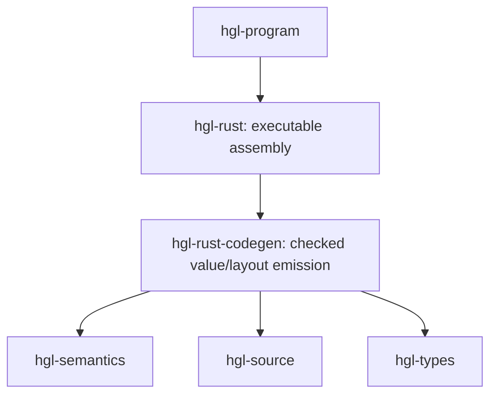

# Card: hgl-rust-codegen

Checked value, layout, ownership and hook source emission below executable
program assembly. This DEC0004(3) layer carries the existing aggregate ceiling
8940 and every moved module ceiling unchanged. It has no runtime dependency.
It depends only on semantics, source and types, never hgl-rust or hgl-program.

The upper hgl-rust crate owns graph registration/construction, generator lifecycle
assembly, cold capacity provisioning and test execution adapters. Its coherent
slice contains 1504 code lines and has ceiling 1700. It depends on this crate;
Cargo rejects a reverse edge as a dependency cycle. Lower emission therefore
cannot call executable assembly or provisioning. It may emit checked metadata,
layout declarations and individual hook expressions, without executing them.

Existing public module paths remain facade reexports. The only newly exposed
items required across the wall are append, any_expression::limits,
constructor_owners::global_bounds, and native_image::image_module. The latter
is pure deterministic provider naming; it never loads or links an image.
The native_image module has ceiling 10 and uses identifiers only.

Validation: cargo check --workspace checks both sides of the dependency wall.
The facade and existing compiler execution tests retain the same source emission
entry points. The full repository CI remains required before final delivery.

Native scalar/layout conversion delegates to native_values; prepared owning-result selection and limits delegate to native_results. These modules share only checked metadata and emission, with no executable assembly/provisioning dependency.

native_results uses layouts and scalars for fixed primitive observations,
configuration and literal emission. Nested non-owning native calls need no result
width callback; owning callbacks compose their declared cold bounds and retain
the single borrowed result in independently reserved storage.

The hgl-rust facade reexports native_results. Its public
validate(&Plan)->Result<(),String> checks concrete runtime owning
provider invocations before target emission. Unsupported prepared argument/result
transport produces a Rust target diagnostic, with no provider execution. Cold
materialization, setup, already prepared snapshots and legacy native bindings
retain their existing paths. Ordinary scalar ValueCall arguments, unsupported
field projections and owning concatenation arguments currently require a future
target transport mapping. Primitive expressions share scalars::binary/unary;
direct input metadata queries and borrowed global-list indices remain prepared.
